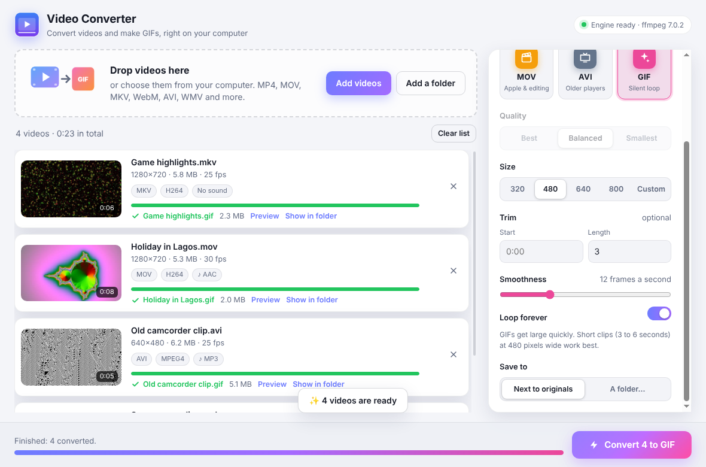

# Video Converter

A desktop app for converting videos to other formats and making GIFs. It runs on your own computer (Windows, macOS or Linux) and nothing is uploaded anywhere. ffmpeg is built in, so there's nothing else to install.



- **Convert to:** MP4, WebM, MKV, MOV, AVI and GIF
- **Opens:** almost any video: MP4, MOV, MKV, WebM, AVI, WMV, FLV, MPEG, TS, 3GP, GIF…
- Drag in lots of videos at once, or a whole folder
- Thumbnails and details for every file (length, size, resolution, codecs)
- Quality (Best, Balanced, Smallest), resizing, and trimming with **Start** and **Length**
- GIFs get a custom colour palette for each clip, so they look much better than a basic conversion. You choose the smoothness (frame rate) and whether they loop
- Live progress, Cancel, and a built-in preview of the finished file
- Never overwrites anything: if `clip.mp4` already exists you get `clip (1).mp4`
- Light and dark mode, following your system setting

## Download and install

Go to the **[Releases](../../releases/latest)** page and download the file for your computer:

| Your computer | File |
|---|---|
| **Windows** | `Video-Converter-Setup-….exe` (installs with a desktop and Start menu shortcut) or `Video-Converter-Portable-….exe` (runs without installing) |
| **Mac** (M1 or newer) | `Video-Converter-…-mac.dmg` |
| **Linux** | `….AppImage` (any distribution) or `….deb` (Ubuntu, Debian) |

### The first time you open it

The app isn't signed with a paid developer certificate, so your computer will ask you to confirm it the first time.

- **Windows:** if you see "Windows protected your PC", click **More info**, then **Run anyway**.
- **Mac:** open the `.dmg` and drag **Video Converter** into **Applications**. The first time, right-click it in Applications and choose **Open**, then **Open** again. If macOS says the app "is damaged", open Terminal and run the command below, then open it again:

  ```bash
  xattr -cr "/Applications/Video Converter.app"
  ```

- **Linux (AppImage):** right-click the file, open **Properties › Permissions** and tick **Allow executing file as program**. Then double-click it.

## Using it

1. Drag videos onto the window, or click **Add videos** or **Add a folder**
2. Pick a format on the right
3. Optionally change quality, size or trim
4. Click **Convert**

When a file is done, click **Preview** to watch it or **Show in folder** to find it.

**Tips for GIFs.** GIFs get large fast. Keep them short (a **Length** of 3 to 6 seconds) and narrow (480 pixels wide is a good start). Times can be typed as seconds (`90`) or minutes:seconds (`1:30`).

### Which format should I pick?

| Format | Good for | Video / audio |
|---|---|---|
| MP4 | Plays almost everywhere: phones, web, WhatsApp, editors | H.264 / AAC |
| WebM | Websites; smaller files at the same quality, slower to make | VP9 / Opus |
| MKV | Archiving | H.264 / AAC |
| MOV | Apple apps (iMovie, Final Cut, QuickTime) | H.264 / AAC |
| AVI | Old players and devices | MPEG-4 (Xvid) / MP3 |
| GIF | Short silent loops for chats, docs and READMEs | GIF, no sound |

## For developers

Built with [Electron](https://www.electronjs.org/) and [ffmpeg](https://ffmpeg.org/) (bundled through `ffmpeg-static`). You need Node.js 22 or newer.

Run it from source:

```bash
npm install
```

```bash
npm start
```

Run the tests (they convert real clips with the bundled ffmpeg):

```bash
npm test
```

Build an installer for the computer you're on (output goes to `dist/`):

```bash
npm run dist
```

### Making a release

GitHub builds the Windows, Mac and Linux installers automatically on every push to `main` (download them from the **Actions** tab). To publish a release, bump `version` in `package.json` and push a matching tag:

```bash
git tag v1.0.1
```

```bash
git push origin v1.0.1
```

### Project layout

| Path | What it does |
|---|---|
| `main.js` | Opens the window and handles file dialogs and conversions |
| `preload.js` | The secure bridge between the window and the rest of the app |
| `src/ffmpeg.js` | Reads file details, makes thumbnails and runs ffmpeg with progress |
| `renderer/` | The interface: `index.html`, `styles.css`, `renderer.js` |
| `assets/icon.png` | App icon |
| `test/` | Tests for the conversion engine |
| `.github/workflows/build.yml` | Builds the installers and publishes releases |
